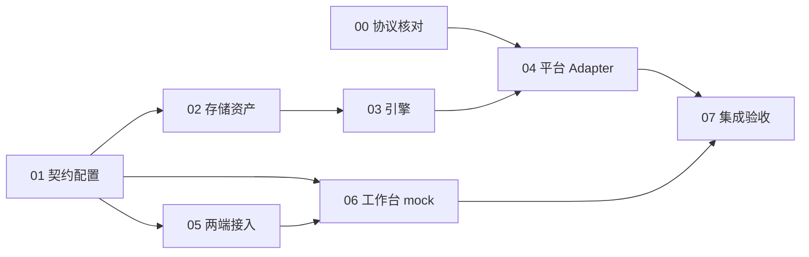

# K-Brain 图像引擎与 LA 设计工作台实施文档入口

2026-10-15 恢复并变基后，当前基线、方案调整和本轮验证见[开发方案复审](../2026-10-15-image-studio-reassessment.md)。历史验收记录保留原日期，本轮未重新执行的场景不算本轮通过。

设计日期：2026-10-11。当前阶段：实施与验收进行中；已有运行代码和 RollDek 真实生成资产闭环，未达到全部目标，也未提交本轮改动。实际状态以[完整回归与计划覆盖记录](../../worklog/2026-10-14-image-studio-full-verification.md)及[RollDek成功收据](../../worklog/2026-10-14-rolldek-https25-success.md)为准，不能把初稿时的状态当现状。

## 已认可的目标

K-Brain 在现有进程中提供独立图像模块；LA 桌面端与 Gateway WebUI 共用设计工作台。覆盖 OpenAI、Google、火山、即梦、RunningHub 的具体产品接口，支持直接返回结果、异步任务与工作流目标。协议未经验证的目标不能启用。品牌名称不等于协议兼容。

## 阅读顺序与文档

| 文档 | 交付范围 | 前置依赖 |
| --- | --- | --- |
| [统一设计与契约](design.md) | 全部文档共享的类型、状态、路由、限制和范围 | 首先阅读 |
| [00 平台协议核对](00-provider-verification.md) | 五个平台的产品选择、官方证据、脱敏 fixture 与可启用条件 | 无 |
| [01 配置与内部契约](01-kbrain-config-contract.md) | 图像连接、目标、能力、秘密引用、后端配置与 HTTP 契约 | design |
| [02 存储与资产](02-kbrain-assets-storage.md) | 设计项目、任务、事件、图片与一致性恢复 | 01 类型 |
| [03 图像任务引擎](03-kbrain-job-engine.md) | 幂等、调度、同步/异步执行、重启与取消 | 01、02 |
| [04 五个平台适配](04-provider-adapters.md) | 各平台原生请求、响应、上传、轮询和错误处理 | 每个平台的 00 证据；01、03 的 Adapter 契约 |
| [05 桌面与 Gateway 接入](05-la-transport-gateway.md) | 客户端、二进制上传、事件恢复、鉴权、导出 | 01；联调依赖 02、03 |
| [06 设置与工作台](06-la-settings-workbench.md) | 共享 UI、目标配置、生成、编辑、历史与比较 | 01；可用 mock 并行，真实联调依赖 05 |
| [07 集成验收与发布](07-integration-release.md) | 双仓版本匹配、自动验证、人工验收和发布门禁 | 00—06 |

## 依赖图

01 与 00 可同时进行。01 冻结后，02、05 的客户端工作和 06 的 mock UI 可以并行。03 使用 fake Adapter 验证，不等待真实平台密钥。04 各平台可以并行，但共用引擎与类型的改动由一个执行者负责。跨仓 Gateway 转发不能 import K-Brain 的 internal 包，必须按冻结 wire contract 实现。

## 实施纪律

- 用户授权当前文档编写；文档不代表已经授权功能实现、付费调用或上线。
- 实现前依各仓实际规则启动匹配目标、检查状态、同步上游并建立任务分支。LA 的 AGENTS.md 要求先启动 `/goal`；不能在现有任务分支上直接开工。
- 保留用户已有修改，不 stash/reset/覆盖。所有计划中的修改路径需要在实施基线上再次确认，新增路径是建议位置。
- 验收通过前不提交或推送实现代码；提交和 PR 统一在 07 执行，不采用技能示例中的每小步自动提交。
- 本地 LA 验收用最新 K-Brain 源码编译；发行版本 pin 更新在 07 单独处理。
- 文档均为中文，建议提交标题、PR 描述也用中文。

## 调查基线与已有设计

本轮检查 LA HEAD：`1055d62d21c60337728435918235cf24958fa657`；K-Brain HEAD：`1e75ec39c26ad2609bc3c87db5af1e8497ff000d`。这不是实施时的上游基线，执行前必须重新确认。

LA 有用户已有的 `.gitignore` 修改及未跟踪文档，均不属于本任务。历史设计 `docs/design/multi-provider-image-generation-platform.md` 的前 160 行已作为背景查看：它主张桌面原生执行、声明式任意 Adapter、自适应 Skill。当前用户认可的设计改为 K-Brain 执行、可信协议 Adapter、专用工作台；不覆盖历史设计、不声称已完整评审它的全部内容。

K-Brain 的 go.mod 目前没有 SQLite 驱动；LA Gateway 有 `modernc.org/sqlite`，两者是不同仓库。首版选择 K-Brain 自有追加日志与快照存储，不凭 Gateway 依赖推断引擎已有数据库。若后续改 SQLite，须整体变更 02 契约与故障测试，不在某个任务中临时引入。

## 需求覆盖

| 需求 | 落实文档 / 验收 |
| --- | --- |
| 五个平台，不假设统一原生协议 | 00、04；07 平台矩阵 |
| 模型与工作流 | 01、04、06 |
| 同步、异步、重启恢复 | 03、04；07 A07—A09 |
| 幂等、取消、未知结果、部分成功 | 02、03；07 A05—A10 |
| 图片持久化、版本、导出 | 02、05、06；07 A11—A14 |
| 桌面与 WebUI 共用 | 05、06；07 双端验收 |
| 连接复用、专属认证、秘密脱敏 | 01、04、05；07 A02、A15 |
| 权限、SSRF、大文件与缩略图 | 02、05；自动化专项 |
| 不影响 Agent/聊天与旧后端 | 01、05、07 回归 |

## 完成标准

单项完成须有对应的可复现测试结果、变更文件和限制。整个任务完成须满足：五个平台所选具体产品的证据与实际接入验收齐全；两端核心流程通过；回归检查通过；用户人工验收通过；按仓规则提交、PR 与 required CI 收敛。某个平台缺少官方接口或授权材料时，报告该平台阻塞，不能将总任务标成全部完成。
