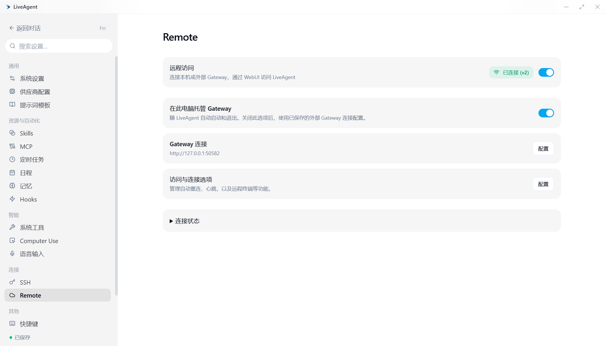

# Windows 桌面 Gateway 自动托管：实现与验收

## 范围与行为

桌面 Gateway 连接控制器原先只连接外部 Gateway，不负责启动 Go Gateway 服务。K-brain 后端是另一条启动链路，不能代替 Gateway。修复将本机 Go Gateway 的进程生命周期与远程连接分开：后台启动打包的 sidecar，确认本次子进程的健康检查成功，再建立桌面 WebSocket 连接。

没有远程设置记录的新安装默认启用本机托管。既有记录不论是否启用、是否已分配 Agent ID，都保持外部模式；明确关闭的状态保持关闭。`managedLocal` 持久化模式选择，本机端口与安装令牌单独保存，切换模式不会改写外部 URL、端口或令牌。安装令牌由 OS 随机源生成并在初始化事务中保存；设置保存不能覆盖此凭据。Gateway 同步只包含原有的 WebUI 功能开关，不包含桌面模式或连接凭据。

退出到托盘时服务存活；真正退出才回收桌面拥有的子进程。Go Gateway 同时监测由桌面保留的 stdin 管道，父进程被强制结束或开发热重载时也会因 EOF 退出。健康检查发送每次启动 nonce 的 SHA-256 探针，验证返回的原始 nonce 后才建立认证连接，避免将凭据发送到抢占端口的外部监听器。端口占用时报告错误，不接管或终止外部服务。启动失败或超时不会阻塞桌面界面，可在解除原因后重试。

## 隔离与复现准备

所有命令从本任务工作区执行，先记录 `git branch --show-current` 和 `git rev-parse HEAD`。原工作区和其他任务进程不参与构建或验证。

Windows 开发启动使用本工作区根目录的本地 `start-tauri-dev.bat`，最终执行 `pnpm --dir crates/agent-gui tauri dev`。该脚本由 `.git/info/exclude` 忽略，不纳入 Git。并行调试设置 `LIVEAGENT_DEV_DESKTOP_PORT=15420`，并通过本地 Tauri 配置覆盖将 `build.devUrl` 设为 `http://localhost:15420`。默认开发端口仍为 1420。

将 `LIVEAGENT_CONFIG_DIR` 设为专用的绝对路径，例如本任务临时验收目录下的 `全新安装`。设置、默认工作目录、聊天历史、聊天同步日志、托管进程日志、Skills、Memory、上传附件与调试文件都应位于该隔离根目录；planning/automation 使用同一设置数据库。第二轮迁移验收使用另一个独立目录。不要复制用户真实数据库来做测试。为本机 Gateway 选择空闲端口，例如 59123；若已被占用，改用其他空闲端口。

开发 Vite、Rust、Go Gateway 与嵌入的 WebUI 必须来自此工作区的同一源码状态。正式安装包应携带 sidecar 与嵌入的 WebUI，启动时不依赖 Go、Node、pnpm 或仓库脚本。

源码开发和构建需要 Go、Rust 工具链、Node 与 pnpm。Tauri 的开发/打包前置命令会准备 sidecar；如果直接运行裸 `cargo check`、`cargo test` 或 `cargo build`，先执行 `pnpm --dir crates/agent-gui gateway:prepare`，以生成与此源码一致的 Gateway 和嵌入 WebUI。Makefile 的检查入口同样包含准备步骤。以上是源码构建依赖，正式安装包运行时无需这些工具。

## 用户界面验收矩阵

以下场景需要真实客户端操作。未收到用户实际反馈的场景均保持“待人工验收”；自动化测试或本地冒烟结果不能代替该反馈。

2026-10-17 用户明确反馈“验证通过”，并提供本机托管已启用、地址 `http://127.0.0.1:50582`、状态“已连接 (v2)”的截图，随后授权提交和推送 PR。该可观察的主流程记为人工通过；下表其他故障、迁移和安装包场景没有逐项人工反馈，不扩大人工通过范围。

| 场景 | 触发方式与操作步骤 | 预期结果 | 人工状态 |
| --- | --- | --- | --- |
| 本机托管与自动连接 | 启用本机托管，启动桌面并查看 Remote 设置页 | 显示本机地址和“已连接 (v2)” | 用户已确认通过，2026-10-17 |
| 新安装自动启动 | 用全新的隔离配置目录启动客户端；打开设置 → 远程访问 | 访问开关与“在此电脑托管 Gateway”均开启；无需启动脚本以外的手动服务命令，连接状态随后为已连接 | 待人工验收 |
| WebUI 可访问 | 打开 Gateway 连接配置，复制本机地址到本机浏览器；复制访问令牌完成登录 | WebUI 静态页面加载，能发现当前桌面 Agent；令牌默认隐藏 | 待人工验收 |
| 真实消息链路 | 在隔离客户端配置可用模型；在 WebUI 选择当前 Agent，发送下文提示词 | WebUI 收到回复；桌面同步出现该对话 | 待人工验收 |
| 关闭并持久化 | 关闭远程访问开关，真正退出后重新启动 | 不启动托管 Gateway，不自动连接；开关仍关闭 | 待人工验收 |
| 重开与恢复 | 在设置开启访问；遇到失败时先排除原因，再展开连接状态并点击“重试 Gateway 连接” | Gateway 变为就绪并连接，客户端始终可操作 | 待人工验收 |
| 托盘存活 | 保持启用，关闭窗口到托盘，刷新本机 WebUI；从托盘重新打开 | 原服务继续响应，重新打开后仍连接 | 待人工验收 |
| 真正退出清理 | 记录本轮 Gateway 子进程 PID，从托盘或退出命令真正退出 | 仅本次拥有的 Gateway 子进程退出；无残留监听 | 待人工验收 |
| 本机端口修改 | 在本机连接配置将端口改为另一空闲端口 | 原服务停止，新端口启动并重新连接；旧地址不再响应 | 待人工验收 |
| 端口冲突与重试 | 在专用测试端口启动一个自有占位监听器，再将本机端口改为该端口；看到错误后仅停止此测试监听器并重试 | 显示端口占用错误；占位监听器不被终止；解除冲突后可恢复 | 待人工验收 |
| 外部配置保留 | 在外部模式填写测试 Gateway 地址/端口/令牌；切换本机模式再切回外部模式 | 原外部配置完整保留；本机凭据不覆盖外部凭据 | 待人工验收 |
| 旧配置迁移 | 使用单独验收数据目录中准备的旧 remote 记录，分别测试 enabled=true 与 enabled=false | 保持外部模式和原有启停状态；未自动接管已有外部服务 | 待人工验收 |
| 重复操作 | 反复打开设置、切换访问开关、连续点击可用的重试按钮 | 最终状态与最后一次操作一致，不留下多份 Gateway 进程 | 待人工验收 |
| 正式 Windows 安装包 | 安装本任务源码构建的安装包到独立验收位置，使用隔离配置目录执行上述新安装、WebUI、关闭、托盘和退出步骤 | 无需系统安装 Go/Node；打包 sidecar 与 WebUI 可用，退出回收子进程 | 待人工验收 |

可直接复制的消息提示词（先配置可用模型）：

```text
请仅回复：Gateway 自动启动验收成功。
```

重复链路验证时使用：

```text
这是 Gateway 恢复连接后的验证。请仅回复：Gateway 重连验收成功。
```

本机诊断命令使用实际验收端口；命令不输出令牌：

```powershell
$gatewayTestPort = 59123
Invoke-WebRequest "http://127.0.0.1:$gatewayTestPort/healthz"
Get-NetTCPConnection -LocalPort $gatewayTestPort -ErrorAction SilentlyContinue |
    Select-Object LocalAddress, LocalPort, State, OwningProcess
Get-CimInstance Win32_Process -Filter "Name = 'liveagent-gateway.exe'" |
    Select-Object ProcessId, ParentProcessId, ExecutablePath
```

## 现有自动化测试

按用户最终要求，本 PR 不新增测试用例或测试脚本，仅运行仓库现有测试。现有 Rust 用例只补齐新增配置字段的默认值；现有前端测试只修正 Windows 文件 URL 路径转换。三平台 CI 构建当前源码的 sidecar 并运行已有 Gateway 与设置测试。

| 现有测试 | 命令 | 实际结果 |
| --- | --- | --- |
| Gateway、设置与连接监督 | `cargo test --manifest-path crates/agent-gui/src-tauri/Cargo.toml --lib -- settings::tests services::gateway::tests services::gateway::connection::transport_supervisor_tests` | 126 项通过，1 个既有外部服务用例 ignored |
| GUI 前端 | `pnpm --dir crates/agent-gui test:frontend` | 3416 项通过，7 个批次 |
| WebUI | `pnpm --dir crates/agent-gateway/web test` | 734 项通过 |
| 既有脚本 | `pnpm check:script-tests` | 31 项通过 |
| 既有发布脚本 | `pnpm --dir crates/agent-gui test:release` | 9 项通过 |
| Go | `go -C crates/agent-gateway test ./...` | Windows 下仅既有 POSIX 文件权限断言失败，其余包通过；Linux CI 运行完整套件 |

本机进程、打包和安装行为的已完成实际冒烟记录见下节；这些观察不等同于新增自动化回归用例。超时、并发、程序缺失等未被既有用例覆盖的路径，不宣称已有自动化回归覆盖。

## 构建与提交前检查

| 验证 | 实际结果 |
| --- | --- |
| `pnpm --dir crates/agent-gui build` | 通过；现有大 bundle 警告，无构建错误 |
| `pnpm --dir crates/agent-gui lint` | 通过，342 文件 |
| `pnpm --dir crates/agent-ui lint` | 通过，607 文件 |
| `pnpm --dir crates/agent-gui test:frontend` | 全部 3416 项通过，7 个批次；同时修复 6 处既有测试使用 URL.pathname 导致 Windows 盘符重复的问题，统一使用 fileURLToPath |
| `pnpm --dir crates/agent-gateway/web build`、lint、test | build 通过、lint 145 文件通过；WebUI 原生测试共 734 项通过 |
| Rust check/build/test | `cargo check --manifest-path crates/agent-gui/src-tauri/Cargo.toml --tests` 通过；最终仅运行现有 Gateway/设置/连接监督测试，为 126 通过、1 ignored；Tauri debug 和 release 构建通过 |
| `go -C crates/agent-gateway test ./...` | Windows 原生完整测试存在基线失败：`store_test.go:410: db file perm = 666, want 0600`，对应代码在基线 85029b56 未改动；现有 config、server 用例通过，cmd/gateway 没有现有测试文件。完整 Go 套件由 Linux CI 验证 |
| sidecar 与 Windows 安装包 | sidecar 原生冒烟通过，含空 PATH、真实 WebUI、认证 API、stdin EOF 后正常退出和 SQLite 句柄释放；NSIS 安装返回 0，安装目录含空格和中文，安装 sidecar 与源码产物 SHA-256 一致；实际安装版的首次自动连接、关闭持久化、崩溃恢复、托盘与退出清理通过 |
| `node scripts/check-ui-boundaries.mjs` | 通过；当前上游已采用 agent-ui 共享源码，旧 check-mirror.mjs 不存在 |
| `git diff --check` | 通过，提交前再次运行 |
| required CI / macOS / Linux 回归 | 随 PR 运行三平台 Desktop Gateway 矩阵和既有 CI，实时结果以 PR checks 为准 |

## 本地实际冒烟记录

开发客户端使用本任务 `start-tauri-dev.bat` 和隔离端口 15420 / 50582 / 19423。实际验证自动连接、关闭后监听消失、重新开启、外部占位监听器保持运行、解除冲突后重试、连续 8 次重连仅保留一个进程、关闭到托盘后健康接口可用，以及真正退出后回收子进程。

最终 NSIS 验证使用同一源码的本地隔离打包配置，仅覆盖 productName / identifier 和开发 URL，避免与用户已安装客户端的单实例、应用数据和卸载项冲突。安装目录同时含中文和空格。全新 `LIVEAGENT_CONFIG_DIR` 自动生成托管配置，在默认 50052 端口启动并连接 v2；关闭状态在退出、重启后保持；重新开启后恢复连接；仅终止本次拥有的 Gateway 后会自动拉起新 PID 并重连；关闭窗口到托盘保持健康；真正退出和强制结束本次桌面父进程都能回收 Gateway 并释放监听。

运行中的真实界面截图：



未执行模型消息验收；隔离环境没有配置模型。完整浏览器登录仍待人工执行，实际 HTTP 页面、嵌入 JavaScript 与认证 API 已由进程冒烟验证。自动审批拒绝了清空 PATH 启动整个安装版及带远程调试参数启动无头浏览器的命令，仅返回 `blocked by policy`；因此没有将这两项记为通过。sidecar 自身的空 PATH 运行已单独通过；安装版采用正常环境启动。Windows 安装包保留 Tauri 默认 WebView2 引导行为，未验证离线安装 WebView2。

每次暂存或提交前运行 `git check-ignore -v -- start-tauri-dev.bat` 和 `git ls-files -- start-tauri-dev.bat`。前者必须命中 `.git/info/exclude`，后者必须无输出。所有人工反馈、自动验证结果、未运行项及外部阻塞应据实更新到 PR。只有 required CI 全部通过，或用户明确接受有证据的外部阻塞后，才能宣告整个任务完成。
