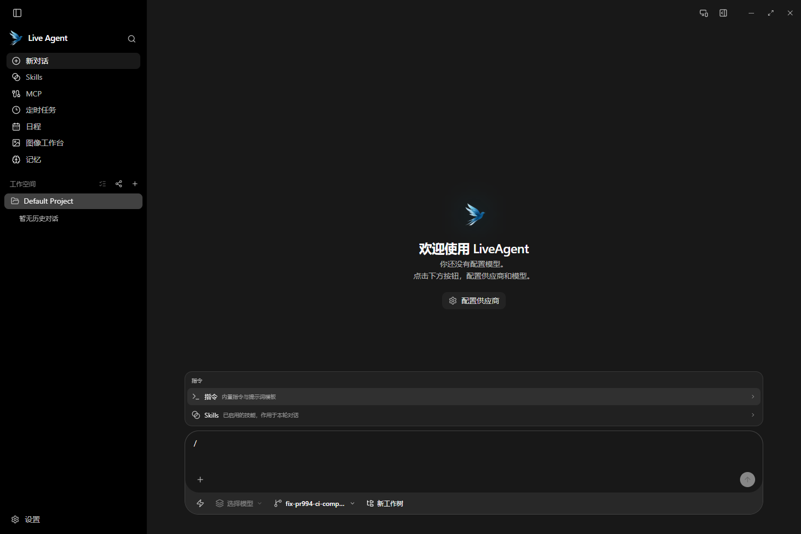
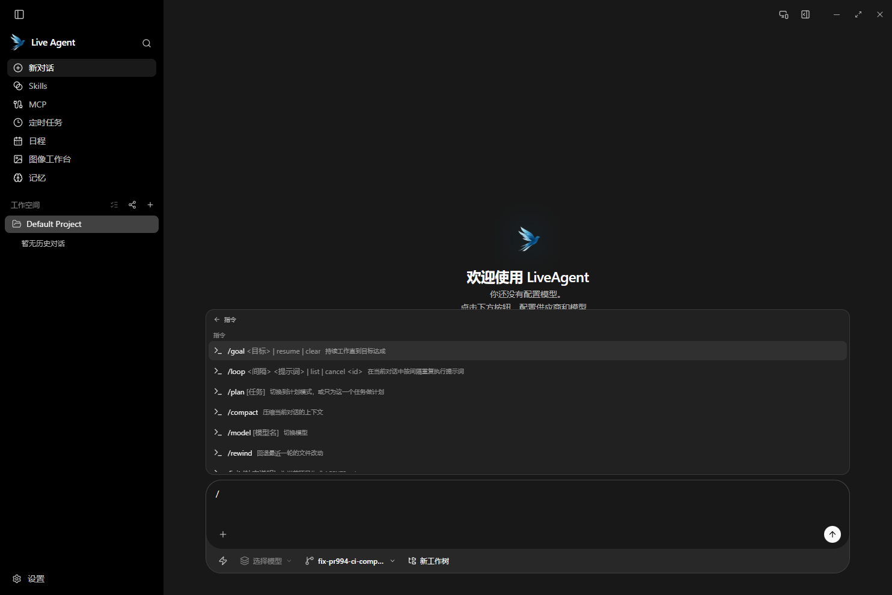
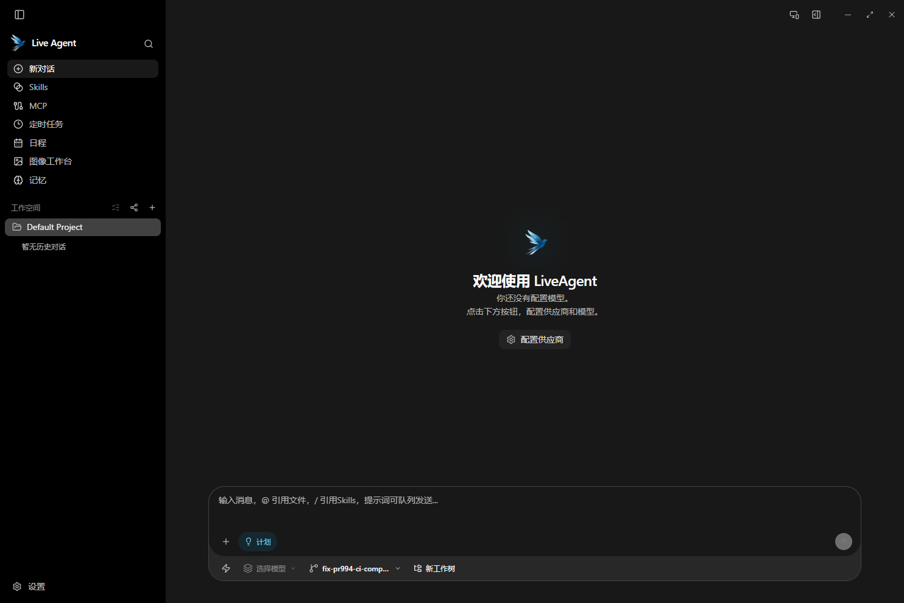
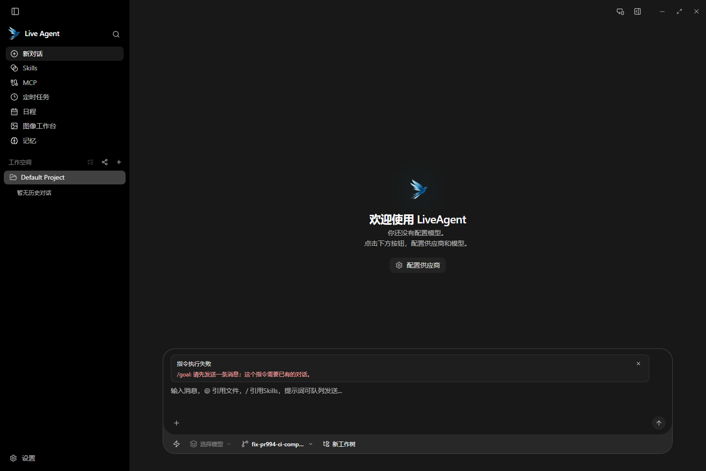

# PR #994 验证与验收记录

关联功能：[issue #1001](https://github.com/Stack-Cairn/LiveAgent/issues/1001)。PR 的目标分支固定为 `v2-kbrian`，验证基线为 `597167c5499f66691fc265c7ac4ac3dc7a52b662`，本次工作树从原 PR head `2537cc0c1d7d91e67ea743e700476657e5b69d49` 创建。

## 本次修正

- WebUI 指令宿主的 memo 补齐 `getDisplayedConversationId` 依赖，避免捕获旧会话读取函数。
- 技能目录 effect 保留用于刷新列表的 `revision` 依赖，并解释其触发用途，消除误报而不删除刷新行为。
- 用户消息末尾换行锚点改用 `String.raw` 表达式，让 JavaScript 运行值与 Tailwind 源码扫描都保留单个 CSS 反斜杠，修复 Vite 开发依赖扫描器的八进制转义解析错误。
- 将上述锚点的既有测试断言改为检查实际渲染的 class；没有新增测试用例。

## 自动验证

以下命令均从本次 PR 工作树运行，没有复用其他 LiveAgent 工作树的前端产物或原生二进制。

| 检查 | 命令 | 结果 |
| --- | --- | --- |
| GUI 类型检查和生产构建 | `pnpm --dir crates/agent-gui build` | 通过；保留已有大 chunk 提示 |
| WebUI 类型检查和生产构建 | `pnpm --dir crates/agent-gateway/web build` | 通过 |
| 共享 UI 类型检查 | `pnpm typecheck:ui` | 通过 |
| GUI lint | `pnpm --dir crates/agent-gui lint --line-ending=lf` | 通过；1 条未改动的 `history.ts` 非空断言 warning |
| WebUI lint | `pnpm --dir crates/agent-gateway/web lint --line-ending=lf` | 通过，无 warning |
| 共享 UI lint | `pnpm lint:ui --line-ending=lf` | 通过；2 条 info |
| 本 PR 改动的前端源码严格检查 | `pnpm exec biome check --line-ending=lf --error-on-warnings <相对 v2-kbrian 变化的前端源码>` | 39 个文件通过，无 warning，1 条冗余 Fragment info |
| GUI 全量前端测试 | `pnpm --dir crates/agent-gui test:frontend` | 3180 项：3179 passed，0 failed，1 skipped |
| WebUI 全量测试 | `pnpm --dir crates/agent-gateway/web test` | 两批合计 793 passed（462 + 331），0 failed，0 skipped |
| GUI 发布脚本测试 | `pnpm --dir crates/agent-gui test:release` | 8 passed，0 failed |
| 仓库检查与发布脚本测试 | `pnpm check:script-tests` | 44 项：42 passed，0 failed，2 skipped（Windows 不暴露 Unix 可执行权限位） |
| 共享 UI 边界 | `pnpm check:ui-boundaries` | 通过；当前源码已用此检查替代删除的 Mirror Check |
| Rust 检查 | `cargo check --manifest-path crates/agent-gui/src-tauri/Cargo.toml --tests` | 通过；12 条未改动文件中的既有 warning |
| Rust 现有库测试 | 下方命令 | 245 passed，0 failed，0 ignored，839 filtered out；不是 Rust 全量测试 |
| Gateway 全量测试 | `go -C crates/agent-gateway test ./...` | 22 个测试包通过，2 个包无测试 |
| Gateway lint | `golangci-lint run --timeout=5m` | 0 issues |
| Proto | `buf lint`；`buf breaking` 分别对 `v2-kbrian` 和 `main` | 均通过 |
| Proto 生成一致性 | 使用仓库生成配置重新生成至忽略目录并比对 | Go、TypeScript 共 4 个文件 SHA-256 字节一致 |
| Diff 卫生 | `git diff --check`；`git diff --check upstream/v2-kbrian...HEAD` | 通过 |

Rust 测试使用 CI 既有过滤组，并包含本 PR 的 Gateway 映射代码：

```powershell
cargo test --manifest-path crates/agent-gui/src-tauri/Cargo.toml --lib -- services::gateway chat_history ssh_local_forward shell_runner integration_commands::mcp services::system_proxy services::kbrain_backend
```

本 PR 的严格前端检查实际使用以下文件选择方式；排除单独验证过的生成代码：

```powershell
$changedSourcePaths = @(git diff --name-only 597167c5499f66691fc265c7ac4ac3dc7a52b662 -- crates/agent-ui/src crates/agent-gui/src crates/agent-gateway/web/src | Where-Object { $_ -match '\.(ts|tsx|css)$' -and $_ -notmatch '/proto/gen/' })
pnpm exec biome check --line-ending=lf --error-on-warnings --max-diagnostics=none @changedSourcePaths
```

Proto 检查从 `crates/agent-gateway` 执行，三条命令均返回 0：

```powershell
mise exec -- buf lint
mise exec -- buf breaking --against 'https://github.com/Stack-Cairn/LiveAgent.git#branch=v2-kbrian,subdir=crates/agent-gateway'
mise exec -- buf breaking --against 'https://github.com/Stack-Cairn/LiveAgent.git#branch=main,subdir=crates/agent-gateway'
```

自动化专用用例包括指令宿主参数分发、单轮计划参数、模板原文保留、cron 转换、记录结果后刷新历史、Gateway 请求白名单和长度校验、proto 映射、末尾换行锚点的渲染值。它们已随上述测试运行，不将这些内部断言计为人工验收。

## Windows 环境修复与跳过项

源码的 `.gitattributes` 要求 LF；Biome 的 `lineEnding: auto` 在本机选择了 CRLF，原始 lint 命令因此出现格式差异。验证时显式传入 `--line-ending=lf`，没有为此改动仓库格式配置或批量重写源码。

最初 GUI 全量测试中的两条 trajectory 用例失败：Windows 后端通过 PowerShell 执行既有 fixture 的 `printf` 命令，而原 PATH 无此可执行文件。只加 `Git\bin` 不能解决；临时加入 `Git\usr\bin` 后，两条原用例以及最终全量测试通过。没有修改 trajectory 源码、fixture 或测试。

```powershell
$env:PATH = 'C:\Program Files\Git\usr\bin;C:\Program Files\Git\bin;' + $env:PATH
pnpm --dir crates/agent-gui test:frontend
```

GUI 保留的 1 条跳过用例为 `real K-brain backend round-trip for uniquely named memory and Skills records`，原因是未设置 `KBRAIN_RESOURCE_CONNECTION_FILE`。这条资源集成用例未执行，不能计为通过。

Gateway 使用 Go 1.25.12。最初 lint 的本机子进程混用了系统 Go 1.27.1；仅在验证进程内将 Go 1.25.12 的 `bin` 置于 PATH 首位并指定对应 `GOROOT`，再执行 golangci-lint 2.12.2 后通过，没有更改项目工具链或持久化环境。

## 原生客户端与依赖来源

从本次工作树运行忽略的 `start-tauri-dev.bat`，最终执行 `pnpm --dir crates/agent-gui tauri dev`。Vite 与新编译的 `target/debug/liveagent.exe` 均来自同一工作树；窗口实际响应，截图从该窗口的 WebView 采集。启动使用独立 `LIVEAGENT_DEV_HOME`，没有使用个人模型凭据。

额外检查了最终生产 CSS 和真实 WebView 的锚点伪元素：`::before` 的 content 为 U+200B，确认修正没有将零宽字符变成可见的反斜杠文本。

原生验收的 K-brain 依赖是 [PR #37](https://github.com/Stack-Cairn/K-brain/pull/37) 的源码 `f9258eb54caa239b5b8366efdd95ef2c689e969b`。从该干净依赖工作树构建 backend 和 computer helper，通过 `LIVEAGENT_KBRAIN_BINARY`、`LIVEAGENT_KBRAIN_COMPUTER_BINARY` 安装为 `development-override`。实际 backend 的 `--version` 为 `pr37-f9258eb54caa239b5b8366efdd95ef2c689e969b`。

仓库锁定发布版仍为 `535fe423876c3ac29c7b344e7002e2b5a16730a3`，本次没有改动发布锁。准备脚本的 receipt 保留该锁值并标记 `development-override`；不能据此将本地验收后端误认为锁定发布版。GUI 自动化测试仍使用默认的校验下载发布版，没有用本地覆盖替代 CI 验证。

## 用户界面验收矩阵

“已操作”表示本次直接操作真实 Tauri 窗口取得的证据；“待配置模型/远程环境”表示提供了步骤但未在本次环境执行。没有将未执行场景计为通过。

| 场景与触发方式 | 操作步骤或可复制提示词 | 预期结果 | 本次证据 |
| --- | --- | --- | --- |
| 裸斜杠分类 | 空草稿输入 `/` | 显示“指令”和“Skills”两类，不发送消息 | 已操作，分类截图 |
| 指令目录 | 点击“指令”分类 | 显示后端目录，内置说明为中文，包含 goal、loop、plan、model 等 | 已操作，目录截图，实际 8 个候选 |
| 取消分类导航 | 在指令目录按 Esc | 回到两类菜单，草稿仍为 `/` | 已操作 |
| 选择保留草稿 | 输入 `/pla`，按 Tab | 草稿变为 `/plan `，没有创建模型运行 | 已操作 |
| 裸计划动作 | 在 `/plan ` 草稿按 Enter | 清空指令草稿并显示计划模式开关 | 已操作，计划模式截图 |
| 无会话错误 | 在新对话发送 `/goal clear` | 显示“请先发送一条消息；这个指令需要已有的对话”，不伪造清除成功 | 已操作，错误截图 |
| 模型切换与未知模型 | 配置模型后选择 `/model`；再发送 `/model 不存在的模型` | 前者打开现有模型选择器；后者显示未找到模型，正常对话不被发送 | 待配置模型；宿主与弹层现有自动化用例已通过 |
| 单轮计划 | 已配置模型后发送 `/plan 请只列出检查仓库的步骤，不修改文件` | 该轮使用计划模式，历史保留指令原文；后续普通消息不继承单轮覆盖 | 待配置模型；现有分发用例已通过 |
| 目标成功、暂停、修改、恢复、取消 | 已有会话发送 `/goal 检查项目结构并给出结果`；依次暂停、修改、恢复；点取消后先拒绝再确认 | 目标栏随状态更新，拒绝取消时保留目标，确认后清除；达成目标后停止续跑 | 待配置模型；不宣称本次完整验证目标生命周期 |
| loop 列表、创建与取消 | 已有会话发送 `/loop 10m 检查当前任务状态`、`/loop list`，再按返回 id 发送 `/loop cancel <id>` | 会话绑定的任务出现，列表和取消结果写入会话；取消后不再调度 | 待配置模型和会话；现有宿主及结果记录用例已通过 |
| loop 边界 | 已有会话发送 `/loop 0m 检查状态` | 显示用法错误，不创建任务 | 现有分发自动化用例已通过；真实会话待验收 |
| 中文输入法与模板原文 | 使用 IME 输入指令搜索；选择模板并填写参数 | 组合输入期间 Enter 不误选；模型侧展开模板，历史保留指令原文 | 弹层与分发自动化用例已通过；真实模型展开待验收 |
| 失败、超时、重复操作 | 在隔离会话使服务不可达或中断连接，重试同一指令 | 明确显示错误或可恢复状态，不将失败结果写成成功，不重复执行已完成动作 | 未进行真实断网/超时与并发重试验收，仍为已知验证边界 |
| 恢复与远程重连 | 重启后打开有目标的会话；WebUI 断连再重连 | 恢复目标为可见暂停态；远程状态和结果与桌面一致，不丢失历史 | 未执行完整 WebUI 目标与 loop 实时同步端到端验收 |

## 截图

以下均为本次原生客户端的实际界面。隔离配置没有模型凭据，因此欢迎区显示尚未配置模型；截图不代表模型运行与远程端到端验收已经完成。









## 仍需关注

- 上游 CI 的最终状态以 PR 当前 head 的 GitHub 检查为准，本文本地结果不能替代尚未运行的 CI。
- K-brain #37 是跨仓库运行时依赖；其 head 不能作为本仓库 Git ancestor 检查对象。本仓库 `v2-kbrian` head 已是 PR head 的祖先。
- WebUI 目标栏、composer-action 的 TS 事件处理、目标指令的完整远程链路、loop 后台结果实时同步、目标循环并发与重试仍沿用原 PR 的未完成或未验收边界；本次治理整改没有宣称完成这些功能。
- 目标轮次等运行时状态的重启恢复、模板与技能引用的全部边界未做新增专项测试；本次遵循不新增测试用例的要求。
